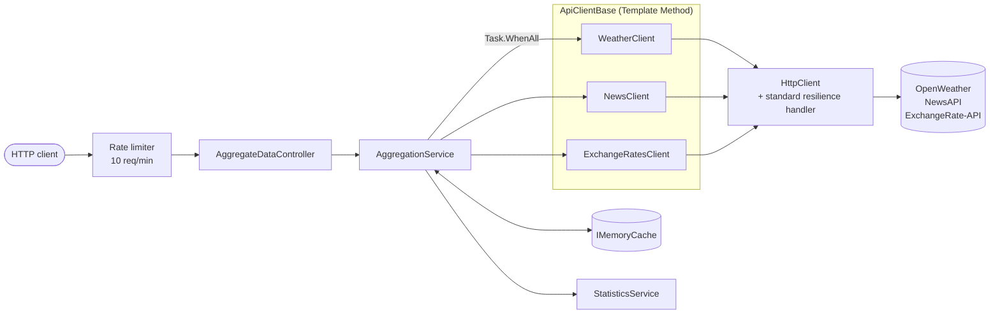

# API Aggregator

[](https://github.com/YannisAm/dotnet-api-aggregator/actions/workflows/ci.yml)

An ASP.NET Core (.NET 10) service that fetches weather, news and exchange-rate data from three external APIs **in parallel** and returns them as a single response.

The focus is on how the service behaves when the outside world misbehaves: slow or failing providers, cancelled requests, concurrent load and abusive clients. Each external source is isolated, so one failing provider never breaks the whole response.

---

## Features

- **Parallel aggregation**: all sources are called at once with `Task.WhenAll`. Total latency is that of the slowest source, not the sum.
- **Graceful degradation**: each source returns its own success or failure. If one provider is down, the others are still returned.
- **Resilience**: per-attempt and total timeouts, retries with exponential backoff and jitter, and a circuit breaker (`Microsoft.Extensions.Http.Resilience`).
- **Caching**: successful responses are cached in memory. Failures are **not** cached, so a provider that recovers is picked up immediately.
- **Rate limiting**: 10 requests per minute on the aggregation endpoint. Excess requests get `429 Too Many Requests` with a `Retry-After` header.
- **Cancellation**: if the client disconnects, the outgoing HTTP calls are cancelled too.
- **Performance statistics**: request count, average latency and latency buckets per source, collected in a thread-safe way.
- **Safe errors and structured logging**: exception details are logged and never returned to the caller.

---

## Architecture



### Design decisions

| Decision | Why |
|---|---|
| Clients return `IApiResult`, and the aggregator collects results into a dictionary keyed by source | Adding a new source only needs a new client class and one DI registration. The aggregator does not change (Open/Closed Principle). |
| `ApiClientBase<TResponse>` (Template Method) | The request flow (API key check, HTTP call, status handling, deserialization, logging, error handling) lives in one place. Each client only defines its URL and optional post-processing. |
| Only successful responses are cached | A short provider outage would otherwise be served from cache for minutes after the provider recovered. |
| Tight timeouts (3 s per attempt, 10 s total) instead of the library defaults | A user is waiting for the response, so a hanging provider must fail fast. |
| `CancellationToken` passed from the controller down to `HttpClient` | Work stops when the caller disconnects, saving resources and third-party quota. An exception filter tells user cancellation (rethrown) apart from a timeout (reported as a source failure). |
| A `lock` per source in `StatisticsService` | `ConcurrentDictionary` protects the dictionary, not the counters inside each entry. A concurrency test with 100,000 parallel calls reproduced lost updates before the fix. |
| Generic error messages for callers, full details in logs | Exception messages can expose internal hostnames and infrastructure. |

---

## API

| Method | Endpoint | Description |
|---|---|---|
| `GET` | `/api/AggregateData` | Aggregated data from all sources. Rate limited. |
| `GET` | `/api/AggregateData/stats` | Per-source performance statistics. |

Main query parameters for `/api/AggregateData`, all optional:

| Parameter | Default | Description |
|---|---|---|
| `Lat`, `Lon` | Athens (37.98, 23.72) | Coordinates for the weather |
| `Units` | `metric` | Weather units |
| `NewsKeyword` | `technology` | News search term |
| `Language`, `SortBy`, `Page`, `PageSize`, `FromDate` | `en`, -, `1`, `10`, last 7 days | News options |
| `BaseCurrency` | `EUR` | Base currency for the exchange rates |

Example response (shortened):

```json
{
  "results": {
    "OpenWeather":   { "source": "OpenWeather",   "isSuccess": true,  "errorMessage": null, "data": { "name": "Athens", "main": { "temp": 21.4 } } },
    "News":          { "source": "News",          "isSuccess": false, "errorMessage": "News is temporarily unavailable.", "data": null },
    "ExchangeRates": { "source": "ExchangeRates", "isSuccess": true,  "errorMessage": null, "data": { "base_code": "EUR", "conversion_rates": { "JPY": 175.99, "USD": 1.11 } } }
  }
}
```

Example statistics:

```json
{
  "OpenWeather": {
    "totalRequests": 12,
    "averageResponseTime": 143.5,
    "performanceBuckets": { "fast": 3, "average": 7, "slow": 2 }
  }
}
```

Latency buckets: **fast** < 100 ms, **average** 100–200 ms, **slow** > 200 ms.

---

## Running the service

You need free API keys from [OpenWeatherMap](https://openweathermap.org/api), [NewsAPI](https://newsapi.org) and [ExchangeRate-API](https://www.exchangerate-api.com). Without keys the service still runs, and each source reports `API key is missing`.

> API keys are never stored in the repository. Use environment variables or .NET User Secrets.

### Option 1: Docker, no clone needed

Each push to `master` that passes the tests publishes an image to the GitHub Container Registry.

```bash
docker run --rm -p 8080:8080 \
  -e ASPNETCORE_ENVIRONMENT=Development \
  -e OpenWeather__ApiKey=<your-key> \
  -e News__ApiKey=<your-key> \
  -e ExchangeRates__ApiKey=<your-key> \
  ghcr.io/yannisam/dotnet-api-aggregator:latest
```

Open <http://localhost:8080> for the Swagger UI. `ASPNETCORE_ENVIRONMENT=Development` enables Swagger. A double underscore (`__`) in an environment variable maps to `:` in configuration.

### Option 2: From source

Requires the [.NET 10 SDK](https://dotnet.microsoft.com/download).

```bash
git clone https://github.com/YannisAm/dotnet-api-aggregator.git
cd dotnet-api-aggregator

dotnet user-secrets set "OpenWeather:ApiKey"   "<your-key>" --project ApiAggregator.API
dotnet user-secrets set "News:ApiKey"          "<your-key>" --project ApiAggregator.API
dotnet user-secrets set "ExchangeRates:ApiKey" "<your-key>" --project ApiAggregator.API

dotnet run --project ApiAggregator.API
```

The Swagger UI is served at the root URL shown in the console. The `ApiAggregator.API.http` file contains ready-made requests for Visual Studio (or VS Code with the REST Client extension).

---

## Tests

```bash
dotnet test
```

20 tests with xUnit and Moq, in three layers:

| Layer | What it covers |
|---|---|
| **Unit: services** | Aggregation, fallback when a source fails, caching rules, extensibility with a new source, cancellation propagation, statistics buckets and thread safety under 100,000 parallel calls |
| **Unit: clients** | Each real client against a fake `HttpMessageHandler`: request URL and API key, response parsing, error status codes, network errors without leaking details, timeout vs user cancellation, exchange-rate filtering and ordering |
| **Integration** | The full application in memory via `WebApplicationFactory`, with only the network layer replaced: response shape, rate limiting (`429` + `Retry-After`) and an unlimited statistics endpoint |

The build treats warnings as errors.

---

## CI/CD

GitHub Actions ([`ci.yml`](.github/workflows/ci.yml)) runs on every push and pull request to `master`:

1. **build-and-test**: restore, Release build, all tests.
2. **publish-image**: only on pushes to `master`, and only if the tests passed. Builds the multi-stage Docker image and pushes it to `ghcr.io` with two tags, `latest` and the commit SHA.

The Docker image uses a multi-stage build: the .NET SDK compiles the app, and the final image contains only the ASP.NET Core runtime and the published output. It runs as a non-root user.

---

## Possible improvements

- Per-client rate limiting (by IP or API key) instead of one global limit.
- Cache each source separately, so one failing provider does not prevent caching the others.
- Tune the circuit breaker thresholds to the real traffic. The defaults expect far more requests than this service receives.
- Return exchange rates as an ordered list. Dictionary ordering is not guaranteed by contract.
- Centralized logging and tracing (Serilog + Seq, or OpenTelemetry) and health-check endpoints.

---

## Tech stack

.NET 10 · ASP.NET Core · C# · `Microsoft.Extensions.Http.Resilience` · `IMemoryCache` · Rate limiting middleware · Swagger (Swashbuckle) · xUnit · Moq · `WebApplicationFactory` · Docker · GitHub Actions · GitHub Container Registry